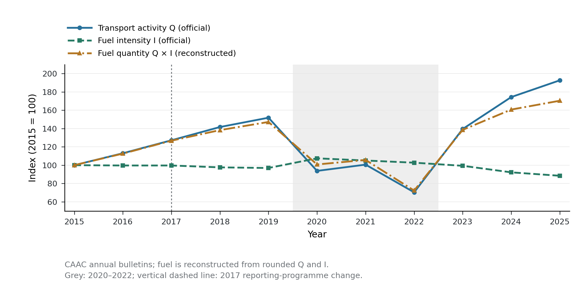
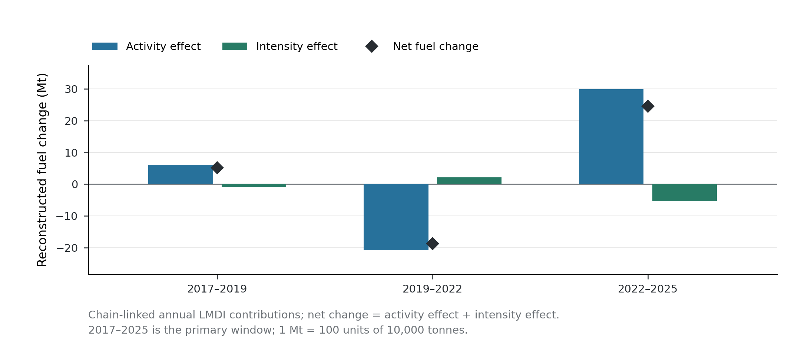
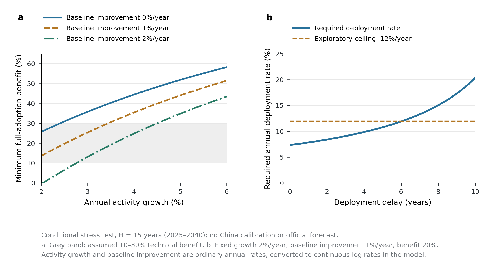

# 论文图表汇集

图1和图2基于官方观测及其核算结果；图3是明确假设下的条件压力测试。具体图注和解释见每幅图下方。

## Figure 1

## Figure 2

## Figure 3

# Figure captions

**Figure 1. Official transport activity and fuel intensity, with reconstructed
fuel use, 2015–2025.** All three series are indexed to 2015 = 100. Transport
activity (Q) and fuel intensity (I) are published annual Civil Aviation
Administration of China (CAAC) statistics; the fuel-use index is reconstructed
from their product and is not an independent fuel observation. The grey area
marks 2020–2022. The vertical dashed line marks CAAC's documented 2017 change in
the statistical processing and review of fuel data; it does not designate an
estimated physical discontinuity. Accordingly, the main decomposition window
starts in 2017, while earlier observations remain visible for context. Lines
connect annual observations rather than interpolated measurements. Source
data: figure1_source_data.csv; the canonical dataset retains original official
source URLs, document hashes and observation locators.

**Figure 2. Chain-linked decomposition of reconstructed fuel changes across
three phases.** Bars show annual additive logarithmic mean Divisia index
(LMDI) contributions summed within 2017–2019, 2019–2022 and 2022–2025. Blue
bars denote transport-activity effects and green bars denote fuel-intensity
effects. Diamonds mark net changes, equal to the sum of the two contributions
within numerical precision. Values are million tonnes (Mt), converted from
10,000-tonne accounting units by division by 100. The primary window begins
after the documented 2017 reporting-programme change. These deterministic
accounting contributions describe reconstructed fuel quantities from rounded
official statistics; they do not identify causal technology effects. Source
data: figure2_source_data.csv.

**Figure 3. Conditional technical-benefit and deployment frontiers over a
15-year horizon.** (a) The minimum technical fuel-intensity benefit required to
avoid an increase in terminal fuel use under full fuel-use-weighted adoption,
as a function of stipulated annual transport-activity growth. Separate curves
assume 0%, 1% and 2% annual baseline intensity improvement. Negative algebraic
thresholds are set to zero when baseline improvement alone meets the terminal
target. The grey band represents an exploratory assumed technical-benefit
range of 10–30%. (b) The required annual deployment rate as deployment delay
increases, with ordinary annual activity growth fixed at 2%, baseline intensity
improvement at 1% and technical benefit at 20%. The dashed line is an
exploratory 12% annual deployment ceiling. Ordinary growth and improvement
rates are converted to continuous log rates in the equations. The terminal
target is the starting year's fuel quantity, and H = 15 represents 2025–2040.
The deployment parameter is the annual conversion rate of the remaining
fuel-use-weighted adoption potential, not the fraction of the aircraft fleet
replaced each year.
These are exact conditional calculations under stated assumptions, without
China-specific calibration; neither the curves nor shaded ranges are official
forecasts, empirical confidence intervals or estimated probabilities. Source
data: figure3a_source_data.csv and figure3b_source_data.csv.
